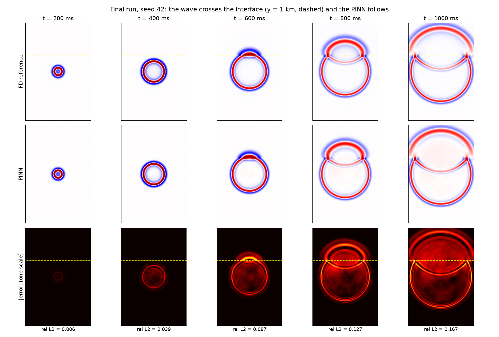
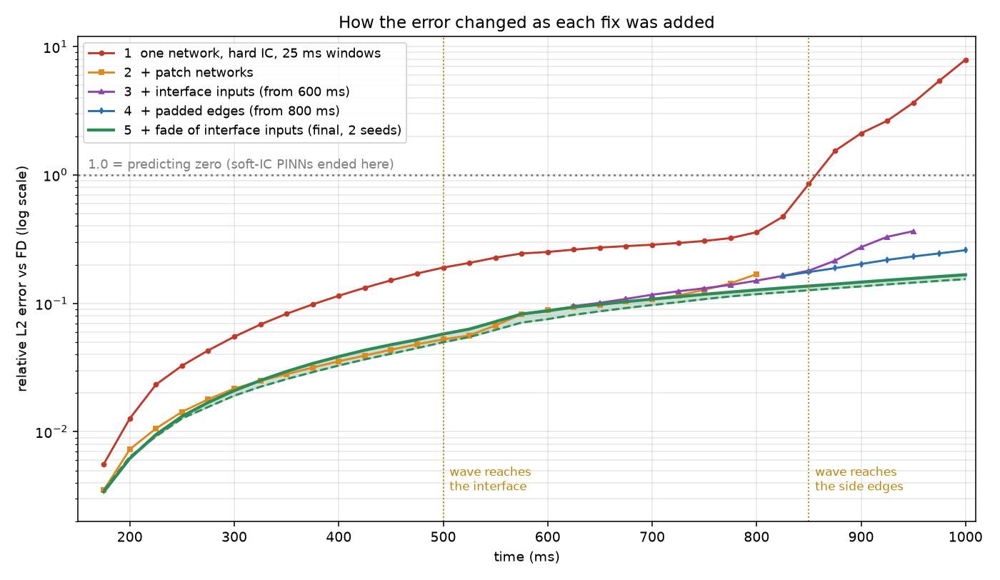
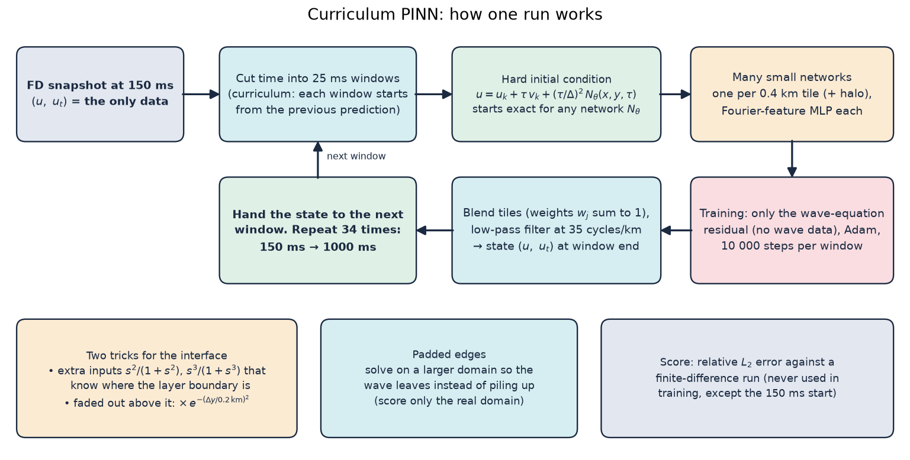
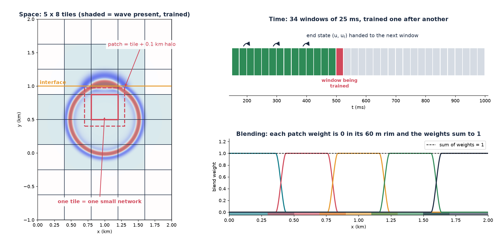

# Ground Motion Simulation of Earthquakes with Physics-Informed Neural Networks

**A time-marching curriculum PINN for seismic waves in a layered medium**

B.Tech Project, Indian Institute of Technology Roorkee (November 2026)
Abhi Raj (23125003) · Kamranjeet Singh (23125016) · Supervisor: Prof. Sohom Ray



## What this is

A physics-informed neural network (PINN) that predicts a 2D acoustic seismic wave crossing a layer boundary
(1 km/s below, 2 km/s above), from **one wavefield snapshot at 150 ms and the wave equation only**, up to 1 s.
A finite-difference (FD) solver provides the starting snapshot and the reference used for scoring.

A standard PINN learns nothing on this problem (relative L2 error ≈ 1, i.e. it predicts zero). We built the method
step by step, fixing one observed failure at a time:

| Problem | Fix | Result |
|---|---|---|
| PINN predicts zero | Hard initial condition, 25 ms time windows (curriculum) | ≈ 1.0 → 0.08 at 350 ms |
| Noise grows window to window | Values-only hand-off, low-pass filter | 0.74 → 0.25 at 600 ms |
| One network too small for the wave | One small Fourier-feature network per 0.4 km tile | 7.9 → stable; 0.36 → 0.17 at 800 ms |
| Noise at the layer boundary | Extra inputs that know where the interface is | 0.169 → 0.150 at 800 ms |
| Wave piles up at the edges | Padded domain | 0.365 at 950 ms → 0.259 at 1 s |
| Smooth offset above the interface | Fade the interface inputs out above it | 0.259 → **0.154–0.167 at 1 s** |



**Final result** (two random seeds): relative L2 error 0.006 at 200 ms, 0.12–0.13 at 800 ms and 0.154–0.167 at 1 s
against the FD reference (0.142–0.156 against a 2× finer FD). Causal loss weights, trainable Fourier frequencies and
longer training were also tested and gave no measurable gain.

## Method in one picture





## Repository layout

```
wave_pinn.py         the method (one file, PyTorch); its defaults are the final recipe
fd_solver.py         finite-difference solver: starting snapshot and reference
plot_results.py      FD | PINN | error figures and error-vs-time curves
run_all.sh / .bat    the final run for one seed;  job_step6.sh: the Slurm job we used
analysis/            scripts behind the figures and tables (written for our working-folder layout)
results/
  images/            method and result figures, snapshots every 50 ms for seeds 42 and 43
  tables/            error per 25 ms window, rescoring against a 2x finer FD, error by region
  logs/              cluster logs of the two final runs
```

## Run it

```bash
pip install -r requirements.txt
python wave_pinn.py --t-end=0.2 --tag=_check     # short check, ~30 min on a GPU (we got 0.0062 at 200 ms)
sh run_all.sh 42                                 # full run 150 ms -> 1 s, ~10.7 h on one GPU
python plot_results.py results/pinn_1000ms_full_s42.npz
```

The defaults of `wave_pinn.py` are the final recipe; `python wave_pinn.py --help` lists every option.

## Main references

Raissi et al. (2019) PINNs · Lagaris et al. (1998) hard constraints · Tancik et al. (2020) Fourier features ·
Krishnapriyan et al. (2021) sequence-to-sequence training · Moseley et al. (2023) FBPINNs ·
Tseng et al. (2023) cusp-capturing PINN.
